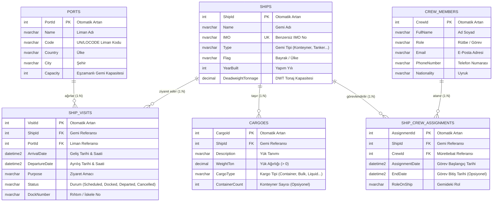

# Liman Gemi Takip Sistemi - Veritabanı İlişki Diyagramı (ERD)

Bu dokümanda **Liman Gemi Takip Sistemi**'nin SQL Server veritabanı şeması, tablolar arasındaki ilişkiler (Primary Key - Foreign Key) ve veri tipleri yer almaktadır.

---

## 📊 Varlık-İlişki Diyagramı (ER Diagram)

---

## 🔗 Tablo İlişkileri ve Kurallar

1. **Ships -> ShipVisits (1 - N):**
   * Bir gemi birden fazla liman ziyareti gerçekleştirebilir.
   * `ShipVisits.ShipId` kolonu `Ships.ShipId`'ye bağlıdır.
   * Silme Davranışı: `Restrict` (Ziyaret kaydı olan gemi doğrudan silinemez).

2. **Ports -> ShipVisits (1 - N):**
   * Bir limana birden fazla gemi ziyareti yapılabilir.
   * `ShipVisits.PortId` kolonu `Ports.PortId`'ye bağlıdır.
   * Silme Davranışı: `Restrict`.

3. **Ships -> Cargoes (1 - N):**
   * Bir gemide birden fazla yük/kargo kalemi bulunabilir.
   * `Cargoes.ShipId` kolonu `Ships.ShipId`'ye bağlıdır.
   * Silme Davranışı: `Cascade` (Gemi silindiğinde yük kayıtları da silinir).

4. **Ships -> ShipCrewAssignments (1 - N) & CrewMembers -> ShipCrewAssignments (1 - N):**
   * Çoktan-çoğa (N-M) personel ve gemi eşleştirmesi ara tablo (`ShipCrewAssignments`) ile sağlanır.
   * **Benzersizlik İndeksi:** `(ShipId, CrewId, AssignmentDate)` üçlüsü benzersizdir; aynı personel aynı gemiye aynı tarihte mükerrer atanamaz.

---

## 🛠️ SSMS (SQL Server Management Studio) İçinde Diyagram Oluşturma Adımları

SQL Server'da Code-First ile oluşturulan veritabanlarında `Database Diagrams` klasörü varsayılan olarak boş gelir. SSMS'in kendi görsel diyagramını açmak için:

1. SSMS'te **Databases** > **LimanGemiTakipDb** klasörünü genişletin.
2. **Database Diagrams** klasörüne sağ tıklayın ve **New Database Diagram** seçeneğini seçin.
3. Çıkan onay uyarısına (*"This database does not have one or more of the support objects..."*) **Yes** deyin.
4. Açılan tablolar penceresinde **Tüm Tabloları (Ctrl + A)** seçin ve **Add** butonuna basın.
5. SSMS tüm foreign key ilişkilerini okuyup ilişkisel diyagramı otomatik olarak ekrana çizecektir.
6. Diyagramı `LimanGemiTakip_Diagram` adıyla kaydedebilirsiniz.
